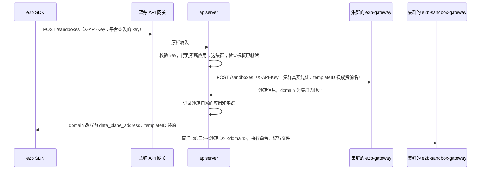

# e2b 沙箱：apiserver 与 e2b 网关的协作

开发者中心兼容 e2b 协议：应用用官方 e2b SDK，把 API 地址指向蓝鲸 API 网关，就能创建和使用沙箱。
沙箱实际运行在各应用集群，apiserver 不运行沙箱，只负责鉴权、选集群、记录归属，以及维护沙箱模板，具体交互透传给集群内的沙箱网关。

## 角色分工

| 角色 | 部署位置 | 职责 |
|---|---|---|
| e2b SDK | 应用代码里 | 发起创建、查询、销毁沙箱的请求；在沙箱里执行命令、读写文件 |
| apiserver | 平台 | 校验平台签发的 API Key；为新沙箱选集群；把请求转发给该集群的 e2b 网关；记录沙箱归属哪个应用；把模板下发到集群 |
| e2b-gateway（控制面网关） | 每个集群一个 | 按模板创建、销毁沙箱。只有 apiserver 访问它，用的是集群自己的凭证 |
| e2b-sandbox-gateway（数据面网关） | 每个集群一个 | 把 SDK 的命令执行、文件读写请求转发到具体沙箱。SDK 直连，不经过 apiserver |
| SandboxTemplate / SandboxPool | 集群内的 CR | 前者描述沙箱长什么样（镜像、CPU、内存、磁盘等），后者引用前者并维持一批预热实例 |

每个集群在平台上登记一份 e2b 接入配置（`ClusterE2BConfig`）：

| 字段 | 含义 |
|---|---|
| `control_plane_url` | e2b-gateway 地址，仅 apiserver 访问 |
| `data_plane_address` | e2b-sandbox-gateway 的对外域名，SDK 用它直连沙箱 |
| `api_key` | 该集群 e2b-gateway 的真实凭证，加密存储，从不下发给用户 |
| `namespace` | 模板 CR 下发到的命名空间，须与网关绑定的命名空间一致 |
| `enabled` | 是否参与新沙箱的调度。停用后存量沙箱仍可续期、销毁 |

## 一次沙箱请求怎么走



几个要点：

1. **两套凭证。** 用户只拿到平台签发的 API Key，由 apiserver 校验；集群网关的真实凭证只有 apiserver 持有。
   API 网关上这些资源不做应用或用户认证，认证完全落在 API Key 上。
2. **新沙箱怎么选集群。** 复用平台的集群分配策略（按应用的租户和 region），在结果里取第一个启用了 e2b 的集群。
3. **归属记录是权限的依据。** 创建成功后，apiserver 记下沙箱属于哪个应用、在哪个集群（`E2BSandbox`）。
   之后的查询、销毁、续期都先按这条记录确认归属，再发往记录里的集群。登记失败时，会立即销毁网关上刚创建的沙箱。
4. **数据面不经过 apiserver。** 网关返回的是集群内地址，SDK 在集群外解析不到，所以 apiserver 把它改写成 `data_plane_address`。
   之后 SDK 直接连到这个地址，命令执行和文件读写的流量都不经过 apiserver。
5. **默认存活时间。** 创建请求没带 `timeout` 时，apiserver 补上 300 秒，否则网关会让沙箱永不过期。
6. **定时对账。** 网关可能自己回收沙箱，网关和本地也可能有一方写入失败。apiserver 每 5 分钟和各集群网关对账：
   本地活跃记录的状态对齐到网关，网关上已不存在的标记为终止；网关上存在、本地却没有记录的孤儿实例，持续超过安全窗口（默认 10 分钟）后销毁。
   对账只修正状态，不改归属。

## 模板

模板决定沙箱用什么镜像、多少资源。SDK 创建沙箱时传入的 `templateID`，就是模板标识。

- **内置模板**：由平台管理员通过平台管理端或运维命令 `e2b_sandbox_template` 维护，所有应用都能用。
  只有"公开"的内置模板会在开发者中心展示；不公开的模板仍能被知道标识的调用方使用，"公开"不是访问控制。
- **自定义模板**：由应用自己创建，只有本应用可见、可用，不预热。

数据库是唯一的事实来源。每个模板在集群里对应同名的一个 SandboxTemplate 和一个 SandboxPool，这个名字叫资源名：

| 模板类型 | 资源名 | 下发到哪些集群 |
|---|---|---|
| 内置 | 与模板标识相同，如 `e2b-envd` | 所有启用了 e2b 的集群 |
| 自定义 | `{应用 code}--{模板标识}`，code 里的下划线转义为 `0us0` | 应用租户可分配、且启用了 e2b 的集群 |

e2b-gateway 把资源名当作 e2b 的 templateID，创建沙箱时从同名的 SandboxPool 里认领预热实例，没有库存时按 SandboxTemplate 现场创建。
所有应用共用同一个命名空间，自定义模板加上应用前缀，不同应用的同名模板才不会互相覆盖。用户始终只看到模板标识，资源名的转换由 apiserver 完成。

## 模板同步流程

### 下发时机

| 触发 | 动作 |
|---|---|
| 创建模板，或修改了镜像、CPU、内存、磁盘、环境变量、工作目录、预热数 | 目标集群的下发记录置为"待同步"，事务提交后异步下发这个模板 |
| 只改名称、描述、启用、公开 | 只写数据库。这些字段不进 CR，不下发 |
| 删除模板 | 下发记录随模板删除，事务提交后异步从各集群删除它的 CR |
| 平台管理端手动同步 | 范围内"不是最新"的记录置为"待同步"，异步执行全量同步 |
| 运维命令 `e2b_sandbox_template sync` | 立即执行全量同步，在终端输出每个集群的结果 |

### 下发流程

```text
单模板下发 / 全量同步（由上表的操作触发）
      │
      ▼
拿全局锁 ──拿不到──▶ 异步任务 10 秒后重试，运维命令直接报错
      │
      ▼
逐个目标集群、逐个模板：
  重新读库(确保数据准确) ──已删除──▶ 单模板下发：从各集群删除平台创建的 CR；全量同步：跳过
      │
      ▼
  写入 SandboxTemplate，再写入 SandboxPool
      │
      ▼
  记录结果（成功 / 失败），以及所下发配置的摘要（根据下发的配置计算）
      │
      ▼
全量同步且未限定模板时：清理已删除模板在集群里残留的 CR
```

- **一把全局锁。** 单模板下发和全量同步共用一把锁，拿到锁之后才读库，所以最后执行的一方用的总是最新配置。
  锁只让向集群的下发排队，不影响模板的增删改。模板保存频率低，没有按模板拆锁。
- **写入是覆盖式的。** CR 不存在就创建，存在就整体替换，重复执行结果相同。
- **只动平台自己的 CR。** 平台下发的 CR 都带 managed-by 标签，删除和清理只处理带标签的 CR，集群里手工创建的不受影响。
- **失败不回滚。** 某个集群或某个模板失败，只记录失败原因，不影响其他集群和模板，由平台管理端的手动同步补齐。

### 下发记录与模板是否可用

每个"模板 × 集群"有一条下发记录，只描述**最近一次**下发：状态（待同步、成功、失败），以及所下发配置的摘要。
摘要只按镜像、CPU、内存、磁盘、环境变量、工作目录这几个字段计算，不包含预热数。

创建沙箱时，apiserver 先选出集群，再看这个集群上的记录：**最近一次下发成功，且摘要等于模板当前配置**，才允许创建；否则返回 409，提示用户稍后重试。
开发者中心展示的模板状态用的是同一条规则，按应用当前会被调度到的集群判断：

| 状态 | 条件 |
|---|---|
| 可用 | 最近一次下发成功，且摘要等于当前配置 |
| 下发失败 | 最近一次下发失败 |
| 同步中 | 其他情况，如刚修改、还没下发完 |
| 无可用集群 | 应用的租户没有启用了 e2b 的集群 |

为什么失败就判为不可用，而不沿用更早的成功结果：SandboxTemplate 和 SandboxPool 分两步写入，失败时集群里可能已经写进了一部分新配置。
这时如果用户把模板改回旧值，旧的成功记录会让模板被误判为可用，用户却拿到新旧混合的规格。

手动同步不会让模板暂时不可用：已经成功下发了当前配置的记录不会被置为"待同步"，重新同步期间照常可用，真的失败了才改为失败。

## 限制

- **预热实例不跟随模板变化。** 修改内置模板后，池子里已经预热好的实例保持旧配置，直到被用完。这些实例不受上面"摘要一致才可用"的保护。
- **停用模板不影响集群里的 CR。** 停用只是不再允许用它创建沙箱，预热实例仍然保留。
- **删除模板前要先销毁它的沙箱。** 还有未终止的沙箱时拒绝删除，因为删除池子会连带销毁它们。应用删除时例外，自定义模板直接删除。
- **集群里手工创建的同名 CR 会被覆盖。** 平台下发时按资源名整体替换，不检查标签。
- **单模板下发失败不会自动重试。** 只有拿不到锁时才重试（每 10 秒一次，最长覆盖锁的 30 分钟有效期）；集群报错需要在平台管理端手动同步。
- **同一份配置重新同步失败，模板也会判为不可用。** 只看最近一次下发，无法区分"集群里还是旧的可用配置"和"写了一半"，直到下一次下发成功。
- **停用某个集群的 e2b 后，它不再接收下发。** 之后的下发会删掉这个集群的下发记录，但集群里已有的 CR 不会被清理。
- **调整摘要包含的字段后，要做一次全量同步。** 否则所有记录的摘要都对不上，模板全部判为不可用。
- **系统盘依赖存储类。** PVC 使用 `AGENT_SANDBOX_E2B_TEMPLATE_STORAGE_CLASS`（默认 `cbs`）指定的存储类，所有启用 e2b 的集群都必须有这个存储类。
