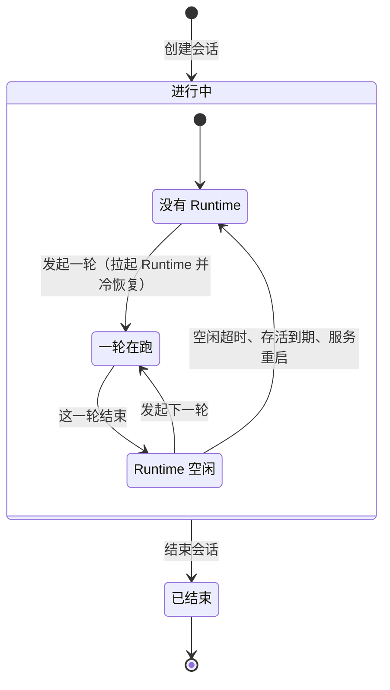
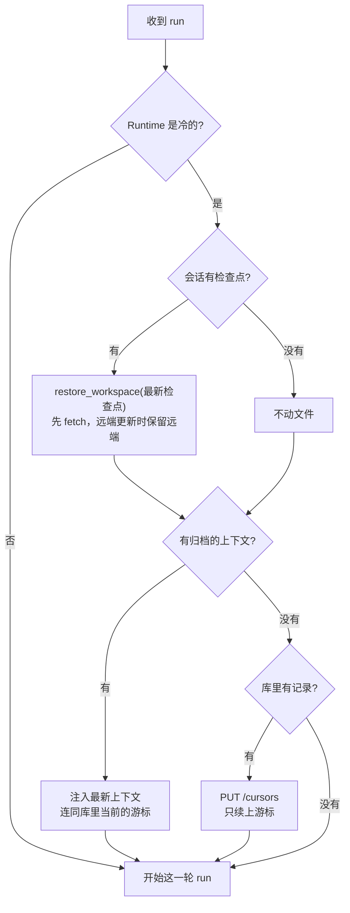

# 会话

一个会话（conversation）是用户和 Agent 围绕一个 Project 的一段连续对话。会话本身存在本服务的库里，Agent Runtime
只是推进会话时临时用的执行环境，可以随时丢弃、重新拉起。所以本服务只在**推进**会话时才需要 Runtime，**查看**会话
从不需要。

## 生命周期

会话的生命周期和 Runtime 的生命周期是两回事，要分开看：

- **会话**只有两种状态：**进行中**和**已结束**。结束是终态，只能由用户显式结束（或删除项目时一并结束）。
- **Runtime** 在会话进行中反复来去：发起一轮对话时按需拉起，空闲超时、到达存活上限或本服务重启后消失，下一轮
  再拉起一个新的，靠[冷恢复](#冷恢复)接上之前的历史。

「进行中」说的不是「此刻有没有 Runtime 在跑」。Runtime 的进程句柄只在内存里，拿它当会话状态的话，同一个会话会因为
一次无关的重启变成「已结束」，下一轮对话又变回来。

| 想知道 | 看哪里 |
| --- | --- |
| 会话还能不能继续 | 会话是否已结束 |
| 这一轮是否还在跑 | 会话状态接口的 `running` |
| 这一轮是否已经全部落库 | `running` 与 `replication_pending` 都回到 `false`，见[复制是最终一致的](#复制是最终一致的) |
| 下一轮能否直接复用现有 Runtime | `runtime_ready`，前端据此显示「正在准备运行环境」 |

会话列表刻意不报运行情况，否则一页 20 条就是 20 次对 Runtime 的健康检查。

## 一轮对话

一轮对话是 Runtime 自己的后台任务，发起时返回的事件流只是在「看」它。客户端断开（刷新页面、关掉标签页、网络中断、
本服务重启）不会打断这一轮，它照常跑完、提交上下文和文件，并把状态回写到本服务。重新进入会话时，看会话状态判断
这一轮是否还在跑，用历史事件接口补上错过的部分。

要提前结束，就显式停止这一轮。停止只对正在跑的 Runtime 发请求，不会为了停一轮去拉起一个；被停下的一轮照常收尾，
已做的部分仍然写入上下文，下一轮的模型看得到。

因为一轮的结束和连接无关，e2b 沙箱的空闲计时也不看连接，而是在收到这一轮的最后一个事件时重新计算。

## 结束会话

结束会话是 Runtime 唯一的对外回收入口。结束之后历史仍然可读，只是不能再发起新的一轮。

- **先标记结束，再回收 Runtime**：标记结束才是真正拦住后续对话的东西，停进程只是尽力而为。顺序反过来，停完进程却
  没标记成功，下一轮对话又会把 Runtime 拉起来。
- **先吊销回写凭证，再停进程**：进程可能已经没了、不理信号，或者本服务早就跟丢了它，吊销凭证才能保证不会再有东西
  以这个会话的名义写进来，所以停不掉只记日志。
- **交还 workspace**：一个 Project 的 workspace 同时只容得下一个 Runtime，停掉之后同一个 Project 的下一个会话才能
  开起来。
- **正在跑的一轮会被打断**：Runtime 按「停止」收尾这一轮，客户端的事件流收到 `RUN_ERROR`。结束会话本来就是
  「别跑了」的意思。
- **拉起 Runtime 期间被结束也拦得住**：拉起要花好几秒，所以发起一轮时在开始前和 Runtime 拉起后各确认一次会话还
  没结束，后一次没过就把刚拉起来的 Runtime 收掉。

## 权威副本

Runtime 在后台把状态推过来，会话历史的权威副本在本服务的库里：

| 数据 | 存在哪 | 用途 |
| --- | --- | --- |
| 原始对话记录 | `ConversationMessage` | 留底，暂无对外读接口 |
| 用户发送的原文 | `ConversationUserMessage` | 和 AG-UI 事件一起恢复界面 |
| AG-UI 事件历史 | `ConversationUiEvent` | 查看历史，直接读库、不起 Runtime |
| 会话上下文 | blob + `ConversationContextVersion`（一版一行） | 冷启动时注入回 Runtime |
| 检查点 | `ConversationCheckpoint` | 冷启动时据此把文件放回去 |

上下文可能有好几 MB，所以存 blob 而不是塞进数据库行里。本地和 Chart 默认存本机目录 `host_tmp_path`；多副本 e2b
要用制品库 `bk_repo`，因为上下文不能只留在单个 Pod 的磁盘上。

- 可选：`AGENT_CONTEXT_STORAGE`；`DATA_UPLOAD_MAX_MEMORY_SIZE`（Runtime 回写的请求体很大，不要调回 Django 默认值）
- 按条件必填：`AGENT_CONTEXT_STORAGE.backend` 为 `bk_repo` 时要配 `BLOBSTORE_BKREPO_CONFIG`

说明和默认值见 [conf.yaml.tpl](../conf.yaml.tpl)「会话状态」。

### 复制是最终一致的

Runtime 在把一轮的 AG-UI 事件流全部发完之后才推送状态，所以客户端收到 `RUN_FINISHED` 时，库里可能还差
几十毫秒。要等一轮真正落定，看 `GET .../conversations/<n>/` 的 `running` 与 `replication_pending` 是否
**都**回到 `false`。

只看 `running` 不够：推送超时不会让这一轮失败（数据还在 Runtime 的本地文件里，后台会继续重试），Runtime
照样会空闲下来。`replication_pending` 报的就是「Runtime 空闲，但库里还差一截」的那一截，落后多少可以看
Runtime `/health` 里的 `pushed_*` 游标。

## 冷恢复

新起的 Runtime 什么都不记得。第一轮 run 进来时，本服务要把两样东西交还给它：**工作区文件**和**会话上下文**。
两者归属不同，各取各的最新，不要求描述同一个时刻；两样都恢复完，才接受这一轮 run。

### 流程

入口是 `lifecycle/utils.py` 的 `resume_if_cold`，在发起 run 和拉起预览（见[工作区应用的预览](misc.md#工作区应用的预览)）的路径上执行：

1. **判断是否冷**：Runtime 报告没有会话、上下文版本为 0、两个通道都没有记录，三条同时满足才算冷。
2. **恢复文件**：拿这个会话最新的检查点（它推过的最后一个提交，连同钉住它的远端 tag）调 Runtime 的
   `restore_workspace`。
3. **恢复上下文**：注入最新归档的那一版上下文，同时把日志和 AG-UI 事件两个通道的游标设为库里现在存到的位置。
4. **接受 run**。

### 关键设计决策

**文件跟 Project，上下文跟会话。** 一个 Project 会被多个会话接着开发，工作分支又只能快进，所以文件最终
落在远端分支的最新提交上，而不是这个会话自己的检查点上。上下文则只属于这个会话，总是取最新一版。

**两者不要求版本配对。** 没改文件的轮次（问答、读文件）不产生检查点，所以上下文领先于检查点是常态；某一轮
的提交已上报、但它的最终上下文没来得及归档时，文件也会领先于上下文。差异交给 Agent 自行感知，它每一轮都
从磁盘读文件。曾经要求两者严格配对，结果纯对话轮次之后冷启动一律被拒，Project 永久卡死。检查点上的
`context_version` 现在只用于排查，冷启动日志会同时打出检查点版本和注入的上下文版本。

**先文件、后上下文、最后才接受 run。** 反过来会留下一个窗口：Runtime 记得自己写过一些还没落盘的代码，这时
进来一轮 run，模型就会基于这个错位行动。

**拉起预览和发起 run 可能同时撞上冷的 Runtime。** 进入项目后用户紧接着发消息，两边会同时看到一台冷的
Runtime；Runtime 把恢复串行化并拒掉晚到的那次，晚到的一方重读 `/health`，发现已经不冷就接着用，不让这一轮失败。

**游标取库里现在的位置，不取检查点上记的。** 检查点是在提交推到远端时登记的，那时这一轮的事件还没复制完。
游标给低了，Runtime 会用已存在的序号给新记录编号，而本服务按序号去重，会把它们当重发静默丢掉。

**冷的判定要看通道。** 第一轮在提交上下文之前就失败的 Runtime 仍报版本 0，但它已经有了自己编号的记录，
接着的本来就是自己的历史。再给它注入会被拒（409）。

### 边界情况

- **从未推过检查点**：不调 `restore_workspace`，只恢复上下文。全新沙箱里 Runtime 启动时就已检出远端分支的
  最新提交。
- **远端已在检查点之后**（被别的会话，或这个会话被中断的那一轮推进过）：Runtime 保留较新的工作并回
  `superseded`，不会被旧检查点回滚。复用的旧 workspace 落后于远端时，会被带到远端最新；恢复前先 fetch，
  避免把已推进的远端误判成「就在检查点」。
- **有记录、没有任何一版上下文**：Runtime 先推日志、后推上下文，第一轮里丢掉的 Runtime 会留下这种状态。
  没有记忆可注入，但仍用 `PUT /cursors` 续上游标；否则新 Runtime 从 1 重新编号，实时输出和历史就对不上了。
- **上下文版本号回退**：上下文没归档就丢了 Runtime 时，新 Runtime 从版本 0 重新计数。所以「最新的检查点」
  按登记先后算，不按 `context_version`。
- **远端不可用，或检查点提交不在远端分支历史里**：`restore_workspace` 显式失败，不静默从空工作区开始。

### 小结

冷恢复只保证两件事：文件和上下文各自回到最新，且都就位之后才接受 run。两者之间的差异是正常的，交给
Agent；真正恢复不了时显式失败，而不是让会话从空白重新开始。

## 归档数据维护

### 上下文版本与检查点的保留

每一版上下文单独存一份 blob（key 里带版本号），归档因此不用加锁、也不用维护「最新」指针，代价是版本会
累积。所以两者都只保留最近 N 个，可选配置 `AGENT_CONTEXT_VERSIONS_KEPT`、`AGENT_CHECKPOINTS_KEPT`，默认值见
[conf.yaml.tpl](../conf.yaml.tpl)。

- **各留各的**：检查点不钉住任何上下文版本。冷启动只用最新的一版上下文和最新的一个检查点，多留的是排障和
  人工恢复的余量。两个值至少按 1 算，配成 0 就等于关掉了冷启动。
- **先删行、再删 blob**：回收在归档新版本之后顺带做。反过来的话，一次失败的远端删除会留下一行指向已不存在
  的文档，这正是冷启动最没法处理的状态；而孤儿 blob 只是占空间。
- **远端 tag 不删**：被淘汰的检查点在远端留下的 tag 不跟着删。删远端引用是可能失败的网络操作，不该让本地
  回收依赖它，一个没人引用的 tag 只占几十字节。
