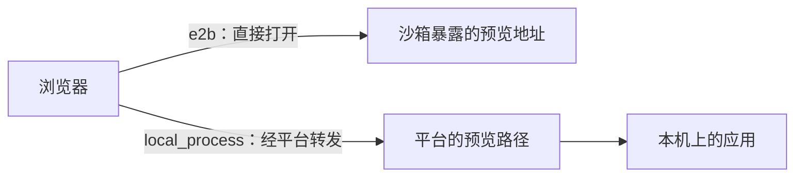

# 其他

## 本服务调用的模型

除了 Agent，本服务自己也会调模型，目前只用来给从一句话创建的项目起名。这类小活儿用不着 Agent 那么强的模型，
所以单独配一套 `LLM_*`，可以换更便宜、更快的模型。

`LLM_SOURCE` 支持三种来源，不配时是 `bkaidev`：

| 来源 | 用途 | 必填 | 可选 |
| --- | --- | --- | --- |
| `fake` | 不发起网络请求的假模型，本地不花钱跑通链路 | — | — |
| `direct` | 直连模型厂商，用配置里固定的 key | `LLM_DIRECT_CONFIG` | — |
| `bkaidev` | 走 bkaidev 网关，凭用户态 access_token 调用 | 同 [Agent 的 bkaidev](agent_llm.md#配置) | `LLM_BKAIDEV_MODEL_ID` |

三种来源都可选 `LLM_TIMEOUT_SECONDS`。说明和默认值见 [conf.yaml.tpl](../conf.yaml.tpl)「本服务调用的模型」。

和 [Agent 的模型](agent_llm.md)相比：

- **配置互不影响**：`LLM_SOURCE` 和 `AGENT_MODEL_SOURCE` 分开配，可以一个走 bkaidev、一个直连。
- **bkaidev 共用网关和换票**：LLM 基址、`TOKEN_AUTH_ENDPOINT` 都和 Agent 相同，但只用一个固定模型，不读
  `BKAIDEV_MODEL_CONFIG`，也没有模型列表。
- **token 要在请求里先换好**：起名在 Celery 任务里执行，后台任务没有用户登录态，所以由建项目的请求先换好
  token，再交给任务。换票失败只让起名失败，项目照常建好。
- **thinking 只在这里控制**：本服务的调用按下面的白名单设置 thinking，Agent 不受它影响。

## bkaidev 网关的 thinking 支持

### 为什么要配

起名这类调用用不着推理，开着思考只会更慢、更费 token，所以本服务的每次调用都会说明要不要思考、思考到什么强度
（例如起名是「能关就关，关不掉就用中等强度」）。

难点在网关：它把 `reasoning_effort` 原样转给后面的模型，而各模型接受的取值不统一，传了不接受的值整个请求返回 400。
所以 thinking 走人工维护的白名单 `_GATEWAY_THINKING_PROFILES`（`infras/llm/models.py`，写法见那里的注释）：

- **不在白名单里的模型不发任何 thinking 参数**，用模型自己的默认行为，请求不会因此失败。
- **在白名单里的模型只发它接受的取值**，要求的强度不在其中时取最接近的那个。
- **关不掉思考的模型**，要求关闭时改用指定强度，而不是发一个它不认的 `none`。

### 维护 effort 时要知道的

- 接受 `none` 不等于能关掉思考（例如 kimi），要看用量；
- 有的模型不回传思考内容（例如混元），只能看 completion tokens 有没有降到只剩答案的几个；
- 厂商自有的开关（`thinking.type`、`enable_thinking`）在网关上基本无效，GLM 还会对 `thinking.type` 报 400；
- pydantic-ai 的厂商档按官方 API 写，借来之前要确认它发出的取值网关都接受。

### 为网关模型适配 thinking

工具是 `scripts/probe_gateway_thinking.py`，凭据与 [live 测试](dev_guide.md#真实模型)相同；网关限频，一个模型要一两分钟。

```bash
set -a; . ~/.app-spark-live-bkaidev.env; set +a
uv run python -m scripts.probe_gateway_thinking list                  # 1. 确认模型 ID（大小写敏感）
uv run python -m scripts.probe_gateway_thinking probe hy3 --repeat 3  # 2. 看接受哪些取值、none 能否关掉
uv run python -m scripts.probe_gateway_thinking verify hy3            # 4. 经白名单实际调用，看发了什么
```

3. 按探测结果写表项，依次考虑：
   - 借 pydantic-ai 的厂商档（自部署的开源模型可试 `VLLMProvider.model_profile`），条件是它发出的取值都被接受；
   - 用 `None` 排除个别会被拒绝的模型；
   - 自己写 `_measured_thinking(...)`，只列接受的取值，`none` 关得掉才列进去；
   - 都不合适就不收录。

   通配符只用于确认过行为一致的同系列模型。
4. 用 `verify` 核对：关思考时要么真的关掉，要么对关不掉的模型发出指定强度，不能失败。
5. 在 `test_gateway_thinking_follows_the_whitelist` 里补上期望值，再跑这个模型的 live 测试：
   `APP_SPARK_LIVE_BKAIDEV_MODEL_IDS=hy3 uv run pytest --reuse-db -m live_llm -k bkaidev tests/infras/llm tests/ext/llm`。

升级 pydantic-ai 后，对借上游档的表项重跑第 4、5 步。

## 工作区应用的预览

模型在工作区里写的应用，用户可以在平台页面里直接打开看效果。

### 怎么工作

预览拆成三件事，各管各的：

1. **Agent 保证应用在约定的端口上跑着**。它不知道自己在外面怎么被访问，所以不负责给出地址。
2. **平台给出浏览器能打开的地址**。每次现查，不存下来：沙箱重建后地址会变。
3. **前端决定什么时候显示**。平台同时告诉前端应用现在的状态（没启动、启动中、可以看了、已停止）；只有「可以看了」
   才显示，「启动中」就继续等。

**进入旧项目时由前端显式拉起。** 查看会话不拉 Runtime，没有一轮对话模型也不会 `launch_app`，所以旧项目
打开后预览会一直空着。前端绑定活跃会话后调 `POST .../conversations/<n>/preview/start/`：按需拉起
Runtime、像发起一轮对话那样恢复文件和上下文（见[冷恢复](conversation.md#冷恢复)），再调 Agent 的
`POST /preview/start`，不等就绪就回 202，之后照常轮询应用状态。应用已在跑就不动它（重启加载新代码只是模型
`launch_app` 的事），所以每次进入都调也安全。`outcome` 为 `no_project` 表示工作区里还没有 `pyproject.toml`，
不是错误。

这是唯一会为「看」付 Runtime 成本的接口，而前端每次进入活跃会话都会调，不先判断项目有没有代码。所以只是
浏览、切换项目，也会为每个进入的会话拉起一台 Runtime，一直占到空闲超时回收（E2B 下预览本身不续期）；没有代码
的项目要等 Runtime 起来才知道是 `no_project`。这是有意接受的成本：换来的是打开旧项目不用发消息就能看到预览，
而新项目和新会话的用户多半紧接着就会发消息，那时本来就要拉起。

地址有两种，取决于 Runtime 跑在哪：



| | 直接打开（e2b） | 经平台转发（local_process） |
| --- | --- | --- |
| 地址 | 沙箱自己的域名 | 平台域名下的一条路径 |
| 谁能打开 | 拿到地址的人都能打开，不经过平台登录 | 要登录平台，且有这个项目的权限 |
| 和平台同源 | 不同源 | 同源 |

### 关键设计决策

- **转发时不带用户的登录凭据**：请求里的 Cookie 和认证头不转给应用，应用设置的 Cookie 也不回给浏览器，所以模型写的
  代码拿不到用户在平台上的身份。
- **同源是经平台转发的最大妥协**：应用和平台在同一个域名下，它的前端代码本来可以带着用户登录态调平台的接口。所以
  转发出去的页面只允许向预览路径本身发请求和提交表单，代价是应用不能从浏览器直接访问第三方服务。直接打开的沙箱
  域名和平台不同源，没有这个问题。
- **直接打开的预览是公开的**：沙箱的预览端口允许不带令牌访问，地址本身就能打开。Agent 自己的接口仍然要令牌。

### 部署前提

- 平台页面是 https 时，预览地址也必须是 https，否则浏览器会拦掉页面里的 http 内容：
  - 直接打开：e2b 的 `port_scheme` 要是 https（默认就是）；
  - 经平台转发：在 Ingress 上终结 TLS 时，Django 要靠 `SECURE_PROXY_SSL_HEADER` 认出原始请求是 https，否则平台
    会把地址签成 http。目前 settings 还没有暴露这一项，需要时先在 settings 里加上，并同步到
    [conf.yaml.tpl](../conf.yaml.tpl)。
- 前端和本服务不同源时，要把只允许同源嵌入的限制（`X-Frame-Options: SAMEORIGIN`）换成 `frame-ancestors`，
  否则前端嵌不进预览页面。

### 经平台转发的已知限制

- 不支持 WebSocket；
- 上传的请求体整份读进内存，不支持流式上传；
- 页面正文里以 `/` 开头的绝对路径（例如 `/static/app.css`）会 404，重定向里的已经改写好了，正文没有改写。
