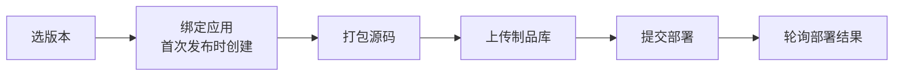

# 发布到开发者中心

项目所有者选一个版本，AppSpark 把它作为标准云原生应用发布到蓝鲸开发者中心的生产环境，拿到可以分享的访问地址。
应用默认模块的源码来源是 AppSpark，代码在 `app_spark_api/publication/` 和 `app_spark_api/infras/bk_paas/`，
发布的各步骤按执行顺序放在 `publication/steps/` 下。

## 前置要求

### 在开发者中心开通权限

缺了下面任何一件，发布都会失败并提示「AppSpark 未获得开发者中心授权，请联系管理员」：

1. 把本服务的 app_code 注册为 AppSpark 系统角色（角色值 100）。在开发者中心 apiserver 里执行：

   ```bash
   python manage.py create_authed_app_user --bk_app_code app-spark --role 100
   ```

2. 在 API 网关上为本服务的 app_code 申请 `BKPAAS_APIGW_NAME` 指向的网关的资源权限，至少包括
   `create_sys_app_spark_app`、`upload_ai_agent_source_package_via_link`、`sys_deploy_with_module`、
   `sys_get_deployment_result`。

### 项目源码

构建方式固定为 `buildpack`，项目源码里要带 `app_desc.yaml` 与 `.python-version`。开发者中心的 Python 构建
工具要支持 heroku-24、Python 3.14 与 uv。

### 配置

开发者中心的系统 API 走蓝鲸 API 网关，以本服务的应用身份调用，不需要用户登录态：

- 必填：`APP_CODE` / `APP_SECRET`、`BK_API_URL_TMPL`、`BLOBSTORE_BKREPO_CONFIG`（源码包存在制品库，见
  [发布用的源码包](repo_server.md#发布用的源码包)）、`RABBITMQ_*`（发布在 Celery worker 上执行）
- 可选：`BKPAAS_APIGW_NAME`（不同版本的开发者中心不一样）、`BKPAAS_APIGW_ENVIRONMENT`、`BKPAAS_URL`

说明和默认值见 [conf.yaml.tpl](../conf.yaml.tpl)「发布到开发者中心」「蓝鲸 API 网关」。

## 怎么工作



1. **选版本**：版本就是会话检查点的 tag，只认本项目会话留下的。不指定时发最新版本，即本项目所有会话里最后登记
   的那个检查点。
2. **绑定应用**：首次发布时在开发者中心创建应用，之后一直复用。已发布时再发布就是更新版本，完成前线上旧版本
   继续服务。
3. **打包、上传、提交部署**：在 Celery worker 上执行，之后由 blue_krill 的 `poll_task` 每 3 秒轮询一次部署结果，
   超过 15 分钟判失败。
4. **展示结果**：任务结束后，发布面板打开时主动展开最近一次部署记录；用户看过之后不再自动弹出，下一次任务结束后
   又会出现。线上版本和最近一次失败不受影响。

接口挂在 `/api/projects/{project_id}/publication/` 下，只对项目所有者可见，其他人一律 404。同一个项目同时只能
有一个发布任务。

## 关键设计决策

- **应用 ID 固定为项目 ID，名称只在首次发布时传一次**。名称默认取项目名称，按开发者中心的规则过滤后为空就用
  项目 ID。AppSpark 不保存名称，也不在本地查重，同名冲突以开发者中心的报错为准。
- **发布状态从任务表推出来，不另存**：线上版本、进行中的任务、最近一次失败都由发布任务记录得出，不会和任务
  本身不一致。
- **提交部署不重试**：worker 崩溃或部署请求结果不明时，不重做也不重发，以免重复部署，让用户到开发者中心查看
  部署记录。轮询只读不写，停了（投递失败、消息丢失）也不重新投递：查询发布状态时，发起 10 分钟还没提交部署、
  或部署超过 15 分钟仍未结束的任务直接判失败。
- **失败按该由谁处理区分**：开发者中心按业务规则拒绝（如已有同名应用）返回 400，detail 原样是开发者中心的说明；
  开发者中心连不上、5xx 或限流返回 502；本服务没配好对接或没获得授权返回 503；本服务内部错误返回 500。
- **打包会占住 worker 几分钟**：`celery-worker` 的并发数要留出余量。

## 脱离 AppSpark 管理

用户在开发者中心把应用改成代码仓库部署后，应用就脱离 AppSpark 管理，之后的发布会失败并提示到开发者中心操作。
