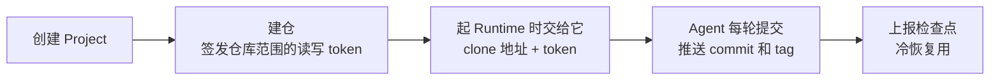

# 源码仓库

源码持久化由 Git 承担：每个 Project 对应 repo-server 组织下的一个**私有**仓库、一条工作分支，Agent 每轮把
改动提交并推上去。Runtime 本身可以随时丢弃，新 Runtime 从远端分支接着干。

## 源码怎么保存



- **建仓**：创建 Project 时建仓，在事务外执行：远端失败会留下 Project 和 `failed` 状态，而不是把刚建好的
  Project 回滚掉。之后可以调 `POST .../git-repository/provision/` 补建或重试。
- **仓库没就绪就不起 Runtime**：发起一轮对话时，仓库不是 `ready` 返回 409 `GIT_REPOSITORY_NOT_READY`，不会
  让 Agent 在一个存不下来的 workspace 里干活。
- **检查点**：Runtime 把 commit 和钉住它的 tag 都推到远端之后才上报检查点，冷恢复靠它把文件放回去，见
  [冷恢复](conversation.md#冷恢复)。

### 配置

- 必填：`REPO_SERVER` 的 `base_url`、`clone_url`、`org`、`service_account`、`service_account_password`；
  `BKKRILL_ENCRYPT_SECRET_KEY`
- 可选：`REPO_SERVER` 的 `type`、`default_branch`、`timeout_seconds`、`commit_author_name`、`commit_author_email`

说明和默认值见 [conf.yaml.tpl](../conf.yaml.tpl)「源码仓库与制品库」。

- **`base_url` 和 `clone_url` 分开配**：两者只在所有东西都跑在同一台机器上时相同。e2b 沙箱里的 Agent 访问不到
  本服务看到的 `localhost`。
- **仓库 token 加密落库**：依赖 `BKKRILL_ENCRYPT_SECRET_KEY`，这个 key 换了就解不开已有的 token。
- **不配时的默认值连不上**：`REPO_SERVER` 有一份指向 `repo-server.invalid` 的默认值，只为让进程能起来，真正
  建仓时会失败。

本地 Forgejo 见 [repo-server/forgejo](../../repo-server/forgejo/README.md)，`init` 会把服务账号密码写在
`secrets/` 下。

## Runtime 怎么拿到仓库

起 Runtime 时，本服务把 `GitRemote`（clone 地址、分支、服务账号、写 token）交给 provider，由它注入 Runtime 的
环境。

- **用的是建仓时记下的 `clone_url`**，不是 `base_url`。用本进程自己的地址，一旦不在同一台机器上，就会把每个
  Runtime 指向它自己。
- **仓库 token 不随 Runtime 停止而吊销**。和状态回写 token 不同，它长期有效，被这个 Project 的每个 Runtime
  共用。拦住被替换掉的旧 Runtime 推送旧历史的，是服务端拒绝非快进推送，而不是收回凭据。

## 源码生命周期管理

### 发布用的源码包

发布时把某个 commit 的源码打成 tgz 传到蓝鲸制品库，再签一个预签名地址交给发布流程下载。

- **包就是 Forgejo 对该 commit 的 `tar.gz` 归档，原样上传，不解压重打**。源码在包里套着一层以仓库名命名的
  目录，开发者中心支持源码位于单个子目录内，所以不必把文件提到包根目录。
- **按「Project + commit SHA」去重**：主分支会被反复发布，只有 SHA 能区分版本；同一个 SHA 不论经由主分支还是
  tag 选中，都只上传一次。
- **只能存制品库**：预签名地址只有制品库能给，所以 `BLOBSTORE_BKREPO_CONFIG` 必填，缺了在第一次打包时就报错，
  不会先去下载归档。

- 必填：`BLOBSTORE_BKREPO_CONFIG`
- 可选：`BLOBSTORE_BUCKET_SOURCE_PACKAGES`，用默认值也要事先在制品库里建好这个仓库

说明和默认值见 [conf.yaml.tpl](../conf.yaml.tpl)「源码仓库与制品库」。

### 回收

源码包不永久保存。上传、复用和签地址都会刷新它的 `last_used_at`，长期没人用的包由命令回收，建议用定时任务
每天跑一次：

```bash
python manage.py delete_unused_source_packages  # 默认删除 15 天未被使用的包，--days 改天数，--dry-run 只列出
```

- **先删行、再删制品库对象**：对象已不存在算删除成功；其余删不掉的情况会列出对象 key，并让命令以失败退出，
  以便有人去手工清理。
- **删项目时一并删除**：Project 只是软删除，外键级联不会触发，所以在删完 Git 仓库之后，用同一套逻辑删掉该
  项目的全部源码包，不看 `last_used_at`。删不掉的对象只记日志，不让项目删除失败：行已经没了，重试也找不回它。

## 边界情况：未保存时下一轮被拒

Runtime 会用 409 拒绝两种完全不同的情况：正在跑另一轮，和上一轮的文件还没推到仓库。两者靠 Runtime 返回的
`detail.code` 区分，对外也是两个错误码：

| 情况 | 错误码 |
| --- | --- |
| 正在跑另一轮 | `AGENT_BUSY` |
| 上一轮的文件还没推到仓库 | `AGENT_WORKSPACE_SAVE_PENDING` |

合并成一个会在 Agent 明明空闲、只是存不上的时候告诉用户「正忙」。

Agent 侧有「本轮不保存也继续」的逃生口（`?allow_unsaved=true`），目前不透传给终端用户：要不要提供它是产品
决定。
