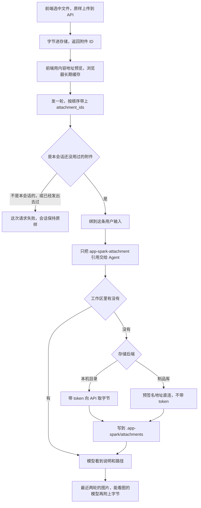

# 会话附件

上传和发送是两步。对话里只留 `app-spark-attachment://<附件 ID>`，字节不进上下文。前端预览始终向 API 要文件；Agent 在一轮开始前按这个引用把文件放进工作区。

单个不超过 5MB，一轮最多 3 个。每个附件只能随一轮发出。

## 前端

选中文件就原样上传（不做前端缩放或重编码，超过 5MB 返回 413），拿到附件 ID 和内容地址。PNG、JPEG、GIF、WebP 用这个地址预览，其余文件按下载展示。内容按 ID 固定不变，响应是 `Cache-Control: private, max-age=一年, immutable`：浏览器长期缓存、不再回源；`private` 是因为要登录，共享缓存不能替别人存。看历史时还是这个地址，浏览器直接用缓存。没发出去的附件留在会话里，没有删除接口。

发一轮时，把要用的 ID 按用户附加的顺序放进 `attachment_ids`。只发附件、不写字也可以。

看历史时，附件挂在那条用户输入上，顺序和发出时一致。

## API

`POST .../attachments/` 把字节写入存储，记一行 `ConversationAttachment`。这时还没有所属的用户输入。类型按内容识别、扩展名辅助。

`POST .../runs/` 先检查这些 ID。不是本会话的附件（404），或者已经随前面某一轮发出去了（409），这次请求失败：不写用户输入，不拉起沙箱，会话保持原样。带了图片而模型不能看图，或者上一轮的图还在、这一轮换成了不能看图的模型，同样是这次请求失败（422）。通过后把附件绑到这条用户输入上，`position` 就是 `attachment_ids` 的顺序。交给 Runtime 的只有引用。

存储记在附件这一行上，以后换部署配置也按这一行找。对前端没有区别：内容接口都从存储读出再返回。

## Agent

用户消息里，图片是 image 段，其他文件是 document 段，地址都是 `app-spark-attachment://<id>`。这个引用会写进上下文；换成说明和字节的那份不写回去。

一轮开始前，工作区里还没有的引用会被下载到 `.app-spark/attachments/<id>/`。这个目录不进 git。换了沙箱、工作区从 git 恢复后目录是空的，下一轮按上下文里的引用再补。

去哪下由控制面按该附件的存储后端决定，放在元数据的 `source` 里：

- 本机目录：相对地址，指向本服务的内部内容接口，请求带 Runtime token。
- 制品库：短时效预签名地址，字节不经过本服务，请求不带 token。

调模型前，引用换成一行说明（文件名、类型、大小、工作区路径），模型用文件工具去读。最近两轮的图片，在能看图的模型上再附上字节。下不下来就换成「附件不可用」，这一轮继续。

## 流程

